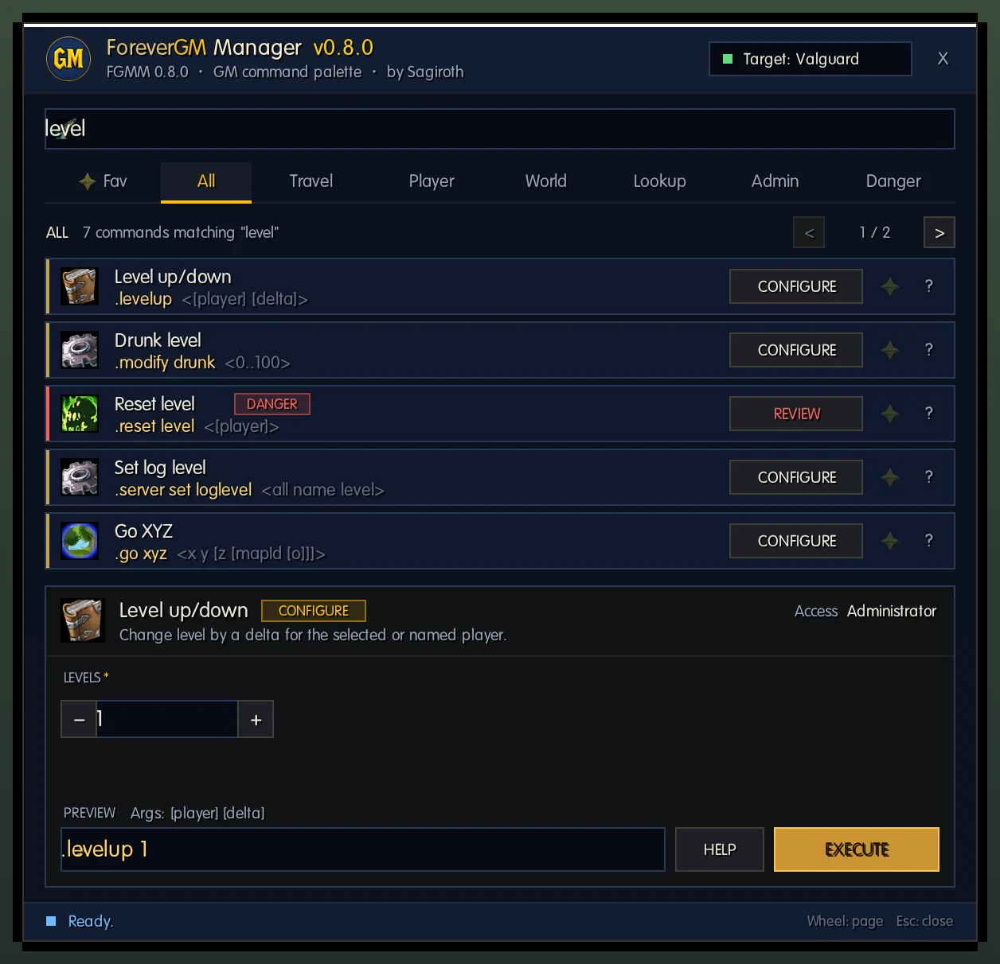
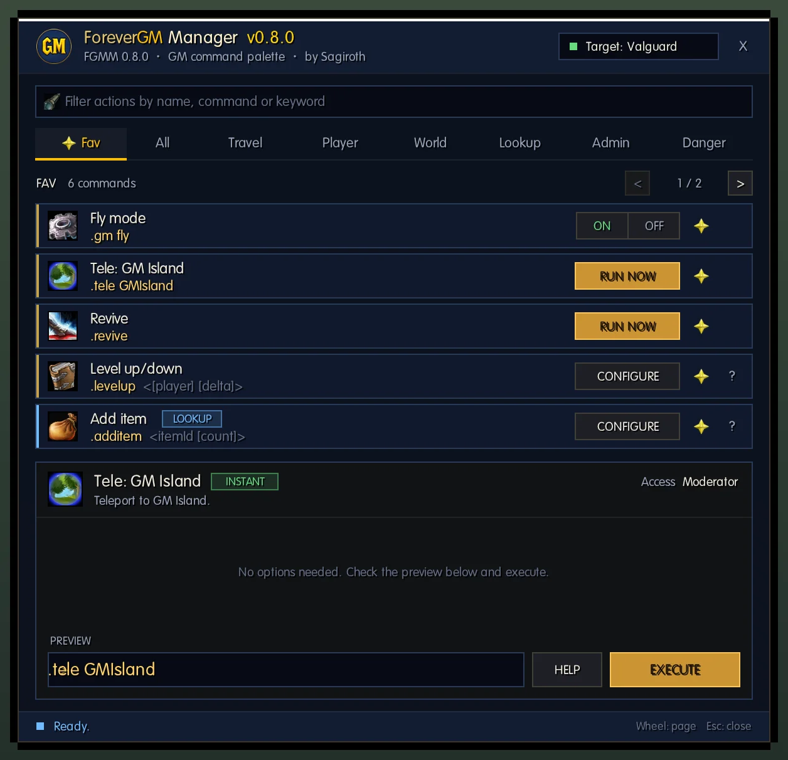
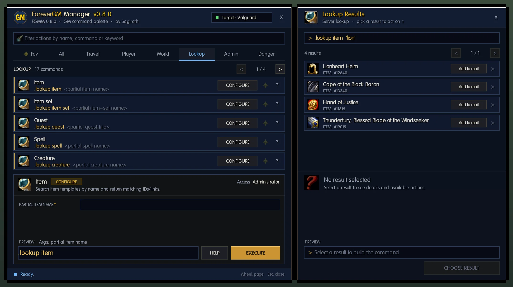
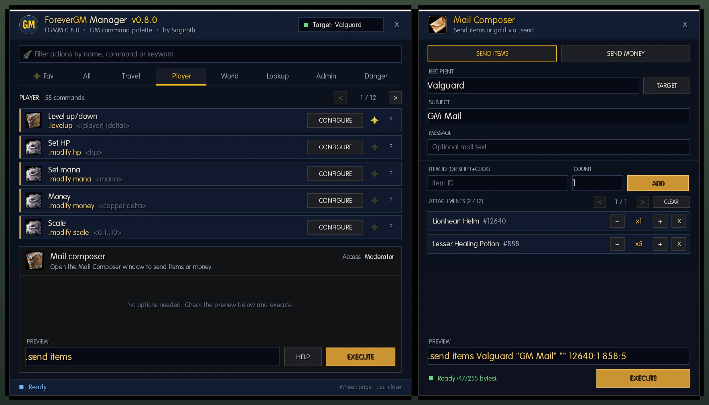
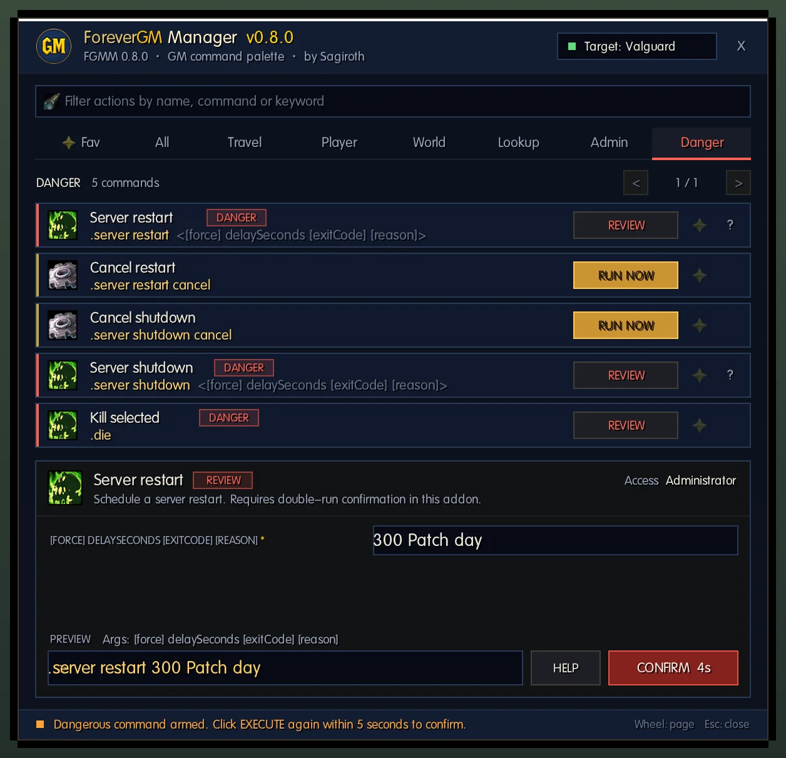

<p align="center"></p>

# ForeverGMManager

A compact GM command manager for **WoW Forever** on **ForeverCore**.

**Status:** Ported to the WoW Forever client. The window, icon, colours and minimap button are checked in the game client; the full command panel has not had a complete in-game pass yet.

ForeverGMManager turns TrinityCore's dot-prefixed GM commands into a small searchable in-game interface. It is built for ForeverCore server administration and testing: teleporting, player and NPC management, items and spells, quests, gameobjects, lookups, moderation, and server utilities.

The addon is **client-side only**. It does not connect to the database and does not bypass server permissions. Commands run through the normal GM chat-command path, and the server's RBAC permissions remain authoritative (a GM account is required).

## Screenshots

<p align="center">
  <br>
  <sub><b>Search</b>: filter the command list as you type and fill in the selected command.</sub>
</p>

<p align="center">
  <br>
  <sub><b>Favourites</b>: starred commands, one-click RUN NOW and ON/OFF switches.</sub>
</p>

<p align="center">
  <br>
  <sub><b>Item lookup</b>: search by part of a name and act on the result.</sub>
</p>

<p align="center">
  <br>
  <sub><b>Mail</b>: send items or gold to a player.</sub>
</p>

<p align="center">
  <br>
  <sub><b>Danger</b>: a risky command needs a second EXECUTE within five seconds.</sub>
</p>

<sub>Rendered offline from the addon's own layout code (<code>tools/preview</code>), not taken in the game client.</sub>

## Features

- Compact structured command palette.
- Draggable minimap launcher; **Shift-drag** moves it and saves its position.
- `/fgmm` opens the manager (`/tgmm` is kept as an alias).
- Fav, All, Travel, Player, World, Lookup, Admin, and Danger categories. Fav opens by default when populated; otherwise All opens.
- **Filter actions** searches the catalogue with label-first ranking without changing the executable command.
- Uses stock interface icons and textures from the installed WoW Forever client; no game texture files or Ace/LibDBIcon libraries are needed.
- Read-only command preview shows the exact GM command before execution.
- Current target is shown in the header with a live indicator.
- Consistent visual system (`Theme.lua`): gold accent, semantic colours for lookup (blue), danger (red), and success (green), underlined category tabs, LOOKUP/DANGER badges, a status bar, and clear empty states.
- The composer header shows the selected action's name, description, and access level; dangerous commands turn **EXECUTE** red and show a live **CONFIRM** countdown while armed.
- Hover tooltips hold detailed descriptions, access levels, and argument help.
- `?` asks the server for `.help <command>`.
- Star any row to add or remove favourites; favourites and window/minimap positions persist in `TortoiseGMManagerDB`.
- Argument-free safe actions use one-click **RUN NOW**; state commands expose direct **ON/OFF** buttons; configurable actions open typed number, text, and lookup-ID controls.
- Persistent or destructive operations require the exact same command to be **EXECUTE**d twice within five seconds.
- Esc closes addon windows through `UISpecialFrames`.

## Database-aware lookup browser

Many GM commands require an ID when you only know a name. Lookup-capable actions expose a dedicated name-or-ID field and **SEARCH** button, separate from the executable command bar.

Example:

```text
Add item -> type thunderfury in ITEM NAME OR ID -> SEARCH
```

The addon sends:

```text
.lookup item thunderfury
```

The server searches its loaded data. Matching `CHAT_MSG_SYSTEM` results are captured into a separate **Lookup Results** window with the result name, type, and ID.

Click a result to select it. The results window shows the originating action, up to three editable modifiers, validation, and the exact read-only command preview. Numeric fields accept keyboard input; `-` and `+` are optional conveniences. Enter runs a valid action.

Normal source actions execute directly in the results window. Dangerous actions keep the two-click confirmation guard, changing the button to **CONFIRM ...**. Changing the result or any modifier clears confirmation. Standalone lookups remain informational; **LOAD COMMAND** is used for source actions that cannot safely execute in place.

Examples:

```text
item       -> .additem <id>
spell      -> .cast <id>
creature   -> .go creature id <id>
gameobject -> .go gameobject id <id>
skill      -> .setskill <id>
```

When **SEARCH** is launched from a specific action such as **Quest add**, **NPC add**, **Add item set**, **Cast**, or **Set skill**, the selected result loads back into that action.

The parser listens to `CHAT_MSG_SYSTEM`; it does not hook chat-frame `AddMessage` methods and does not suppress server output.

## Command coverage

The catalogue is checked against `Karrz1/TrinityCore` (`forever-bots`) command tables and RBAC default permissions. See [COMMANDS.md](COMMANDS.md) for the full generated table of all **183 presets** and **26 SEARCH mappings**.

- GM mode, visibility, chat badge, cheats (god, casttime, cooldown, power, waterwalk, taxi, explore), GPS, revive, repair, bank, mailbox, unstuck, and time utilities.
- Saved teleports (`.lookup tele` and `game_tele` shortcuts including Forever custom zones), player teleport/summon, coordinate/offset movement, and fly mode.
- Items, item sets, spells, auras, cooldowns, skills, reputation, morph/demorph, mail/send, and level/character/reset utilities.
- NPC and gameobject lookup, spawn (persistent and temporary), movement, targeting, activation, and deletion workflows.
- Quest, instance bind, and game event management.
- Item, item-set, spell, quest, creature, object, tele, faction, skill, event, area, map, taxinode, title, and player/account lookups.
- Save, reload, server info, announcements, and moderation commands.

Commands not present in the server registry are not advertised.

## Installation

1. Download or clone this repository.
2. Copy the folder into your WoW Forever client's `_forever_/Interface/AddOns/` directory and name it `ForeverGMManager`:

```text
<WoW Forever>/_forever_/Interface/AddOns/ForeverGMManager/ForeverGMManager.toc
```

3. Start or restart the WoW Forever client.
4. On the character-selection screen, open **AddOns** and enable **ForeverGMManager** (enable **Load out of date AddOns** if prompted).
5. Log into a GM character.
6. Click the hammer icon next to the minimap, or run `/fgmm` (alias `/tgmm`).

### Minimap controls

```text
Click       open / close ForeverGMManager
Shift-drag  move the minimap icon
Right-click hide the minimap icon (run /fgmm minimap or /tgmm minimap to show it again)
```

Window and minimap positions (and visibility) are saved automatically.

## Basic workflow

1. Select a player, NPC, or object when the command targets one.
2. Pick a category or use **All** and search.
3. **RUN NOW** runs safe argument-free actions in one click.
4. State actions expose direct **ON/OFF** buttons. **CONFIGURE** opens typed controls for commands that take values.
5. The lookup field appears for lookup-capable actions and in the Lookup tab. Type a name or ID and press Enter to search, or click **SEARCH**.
6. Numeric IDs compose the action right away; names are resolved via server lookup.
7. Click a lookup result to populate the action panel below, adjust modifiers if needed, and run or press Enter. Dangerous actions require clicking twice within five seconds.

For server-specific syntax, hover an action or click `?` to request `.help <command>`.

## Safety model

Persistent or destructive operations are not one-click actions. Examples include server restart/shutdown, NPC/gameobject persistence changes, saved teleport edits, broad `learn all` / `learn my` commands, moderation actions, quest removal, and `.die`.

For a dangerous command:

1. The first **EXECUTE** arms the exact command.
2. The same command must be **EXECUTE**d again within five seconds.
3. Editing the command or parameters clears the pending confirmation.

Cancellation commands such as `.server restart cancel` remain immediate.

## Server alignment

The addon catalogue is verified against a local `Karrz1/TrinityCore` (`forever-bots`) checkout:

```text
src/server/scripts/Commands/cs_*.cpp
src/server/scripts/Custom/Classic/world/classic_*_commands.cpp
src/server/game/Accounts/RBAC.h
sql/base/auth_database.sql
```

`tests/verify_server_catalog.py` parses the server `ChatCommandTable` registry and RBAC security levels, then checks all addon presets, `SEARCH` routes, displayed access levels, and whether `COMMANDS.md` matches `Data.lua`.

By default it looks at `forever-local/src` next to this repository (`../forever-local/src`). Point it at another local checkout with `FOREVER_SERVER_SRC`:

```bash
FOREVER_SERVER_SRC=/path/to/TrinityCore python3 tests/verify_server_catalog.py
```

## Project structure

```text
ForeverGMManager.toc
Data.lua        command catalogue and danger policy
Theme.lua       shared visual system: colours, buttons, tabs, inputs, badges
Core.lua        execution, history, help, and confirmation logic
Lookup.lua      lookup lifecycle and CHAT_MSG_SYSTEM parser
UI.lua          compact main palette and minimap launcher
ResultsUI.lua   separate lookup-results browser
COMMANDS.md     generated command reference (from Data.lua)

tools/
  gen_commands.py       generates COMMANDS.md from Data.lua
  preview/              offline renderer for the README screenshots

tests/
  core_spec.lua
  lookup_spec.lua
  verify_server_catalog.py
```

## Development checks

```bash
lua5.1 tests/core_spec.lua
lua5.1 tests/lookup_spec.lua
python3 tests/verify_server_catalog.py
luac5.1 -p *.lua
python3 tools/gen_commands.py
```

Run `python3 tools/gen_commands.py` whenever `Data.lua` changes; `tests/verify_server_catalog.py` fails if `COMMANDS.md` is out of date.

To redraw the README screenshots after a UI change, run `sh tools/preview/run.sh <out dir> <asset dir>` (needs Node with Playwright, Python with Pillow, and the client fonts `FRIZQT__.ttf` and `ARIALN.ttf` in `<asset dir>/fonts`; fonts are not in the repo), then convert the PNGs to `docs/screenshots/*.webp`.

## Project scope and affiliation

This repository contains client-addon source code, project artwork, and documentation. It does not distribute game-client binaries or extracted game data, provide hosting, or operate a game service. It is an unofficial community project made for educational purposes. It is not affiliated with or endorsed by Blizzard Entertainment or the WoW Forever project. World of Warcraft and related marks belong to their respective owners.

## Licence

Released under the [AGPL-3.0](LICENSE) license. Original MIT-licensed code from TortoiseGMManager is documented in [NOTICE.md](NOTICE.md).
